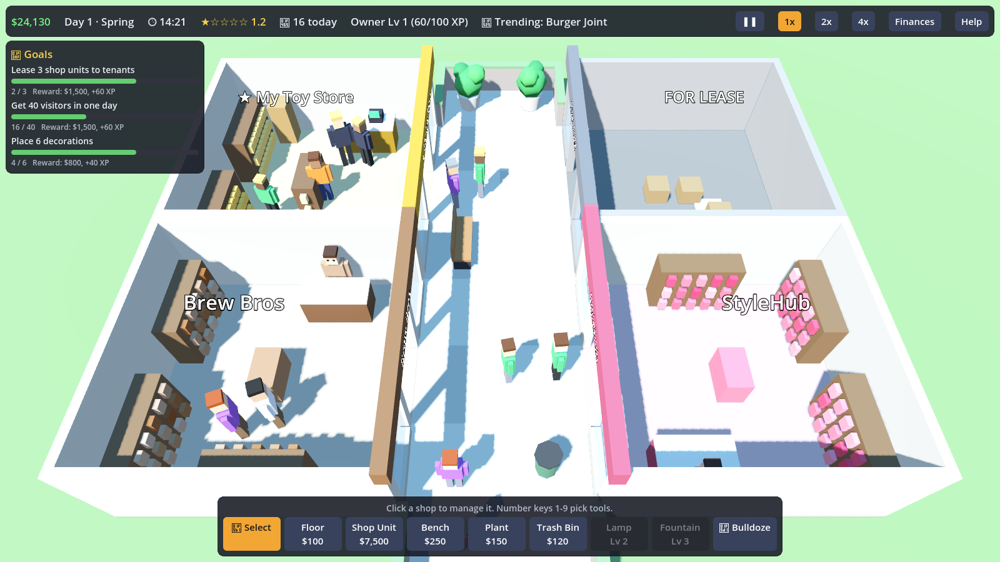
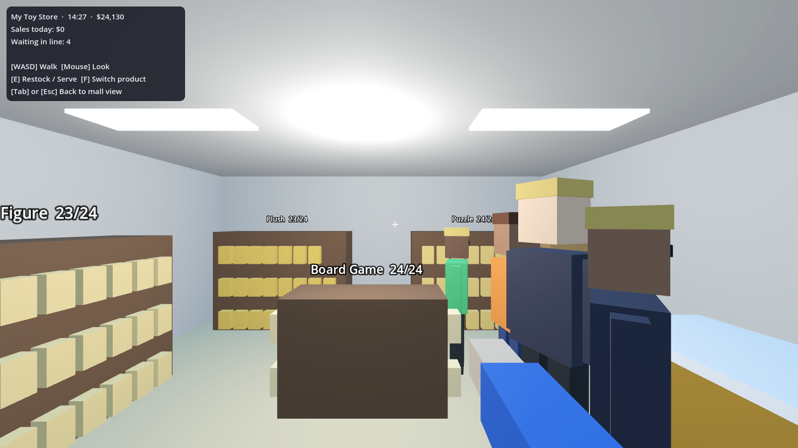

# Mall Tycoon

A 3D mall-owning simulator made with **Godot 4.3**. You own the whole mall: build it, rent units to business
owners, and run up to 5 shops yourself in first person. One mall, no levels, it lasts forever. But if your
money ends the day below $0 three days in a row, you go bankrupt.

## How to play

1. Install [Godot 4.3](https://godotengine.org/download) (the standard version, not .NET).
2. Open Godot, click **Import**, and pick this folder's `project.godot`.
3. Press **F5** (or the ▶ Play button).

### Controls

**Mall view (top-down 3D)**
- WASD / arrow keys: move the camera
- Q / E or right-mouse drag: rotate
- Mouse wheel: zoom
- 1–9: build tools · R: rotate a shop unit · Esc: cancel · Space: pause

**Inside your own shop (first person)**
- WASD: walk · Mouse: look
- E or left click: restock a shelf / serve the customer at the register
- F: switch which product a shelf holds
- Tab or Esc: back to the mall view

## What's in it so far

- Grid building: floor tiles, 3x3 shop units (with a door that must touch the floor), decorations
- Tenants with personalities: rent, happiness, late payments, rent-cut requests, moving out
- Big chain stores that only move in when your mall rating is high enough
- Your own shops: order stock, set prices, stock shelves, run the register, or hire a cashier and stocker
- Shoppers who walk around, want specific shop types, complain, and rate your mall
- Day/night cycle, seasons, trending shop types, random events, and a rival mall
- Mall star rating, owner levels with unlocks, and an endless list of career goals
- Loans, marketing campaigns, cleaners, security, dirt and litter
- Autosave every night (Continue from the main menu)

## Developer tools

- `godot --headless --path . -- --autotest` plays several days at high speed and prints a daily summary
  (set `AUTOTEST_DAYS=10` to change how many).
- `SHOT_DIR=/some/folder godot --path . -- --shots` saves screenshots.

## Project layout

- `scripts/game.gd`: all game state and simulation (autoloaded as `Game`), plus saving
- `scripts/data.gd`: shop types, products, build items, goals and balance numbers
- `scripts/main.gd`: input, build tools and switching to first person
- `scripts/world_view.gd`, `scripts/unit_view.gd`, `scripts/art.gd`: the 3D visuals
- `scripts/shopper.gd`, `scripts/shopper_manager.gd`: shopper behavior and checkout lines
- `scripts/hud.gd`: all UI
- `scripts/camera_rig.gd`, `scripts/fp_player.gd`: cameras
